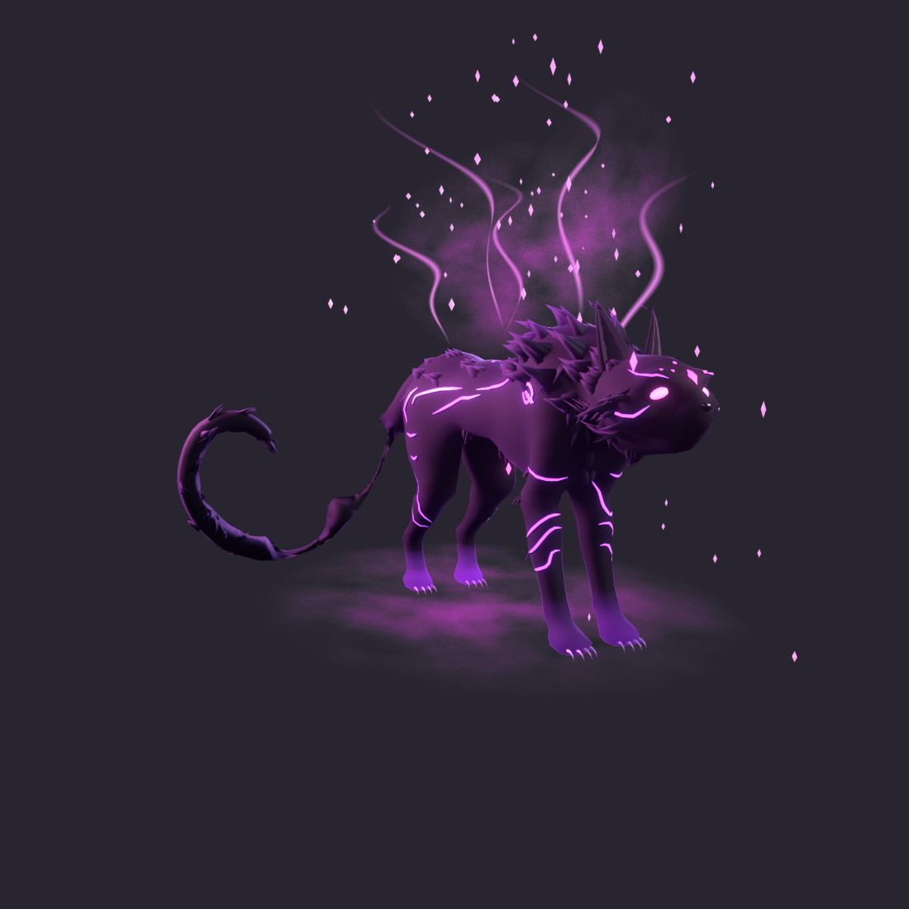

# Kucing Bayang Ungu (Shadow Cat)

Model kucing bayang untuk Roblox, dibina dalam Blender 5.2 LTS berdasarkan imej rujukan.
Status: **FBX untuk Roblox sudah dieksport** (`export/kucing_bayang_roblox.fbx`).



## Fail

| Fail | Isi |
| --- | --- |
| `kucing_bayang.blend` | Model + efek preview + kamera/lampu preview |
| `preview/` | Render PNG lutsinar (tiada latar). Fail `sheet_*` diletak atas kelabu neutral untuk semakan sahaja |
| `export/kucing_bayang_roblox.fbx` | FBX untuk Roblox: 15 mesh, ~11k segi tiga, tanpa efek, kamera atau lampu |
| `export/SetupKucingBayang.lua` | Skrip Command Bar Roblox Studio untuk warna dan bahan (Neon) |
| `scripts/` | Skrip Python untuk bina semula model dari kosong dan eksport FBX |

## Collection dan objek

Semua objek model ada transform yang dah di-apply. Origin di (0,0,0), iaitu di atas lantai di antara kaki.
Kucing menghadap -Y, Z ke atas, dan 1 unit = 1 m. Panjang kira-kira 1.43 m, tinggi 0.70 m.

**`CAT_Model`** (model, ~11k segi tiga):

| Objek | Segi tiga | Nota |
| --- | ---: | --- |
| `Cat_Body` | 5,324 | 2,662 quad, mesh tertutup (manifold), 7 pulau UV: badan, kepala+leher, 4 kaki, ekor |
| `Cat_Ears` | 172 | Telinga runcing + bahagian dalam (bahan berasingan) |
| `Cat_Eyes` | 288 | Mata magenta menyala |
| `Cat_Nose` | 100 | |
| `Cat_Claws` | 320 | 16 kuku tajam melengkung |
| `Cat_Glow_Markings` | 756 | Corak ungu bercahaya di muka, bahu (pusaran), badan dan kaki |
| `Cat_Glow_ForeheadDiamond` | 38 | Tanda berlian di dahi + titik-titik di sekelilingnya |
| `CAT_Fur/Cat_Fur_Head` | 1,110 | Kelompok bulu: ubun-ubun, pipi, leher bawah, jambul telinga |
| `CAT_Fur/Cat_Fur_Mane` | 1,020 | Surai tajam di tengkuk dan bahu |
| `CAT_Fur/Cat_Fur_Chest` | 300 | |
| `CAT_Fur/Cat_Fur_Back` | 360 | |
| `CAT_Fur/Cat_Fur_Belly` | 270 | |
| `CAT_Fur/Cat_Fur_Legs` | 360 | Siku dan belakang paha |
| `CAT_Fur/Cat_Fur_Tail` | 560 | Hujung ekor yang melengkung |

**`FX_Preview`** (untuk preview sahaja, tidak disambung kepada model, kena bina semula dalam Roblox Studio):

| Objek | Cadangan dalam Roblox |
| --- | --- |
| `FX_Smoke_Back`, `FX_Smoke_Shoulder`, `FX_Smoke_Ground` | `ParticleEmitter` asap ungu (Volumetric/Smoke) |
| `FX_EnergyRibbons` | `Beam` atau `Trail` dengan tekstur gradien magenta ke ungu |
| `FX_Sparks_Magenta` | `ParticleEmitter` percikan magenta (LightEmission tinggi) |

**`Preview_Setup`**: kamera dan 4 lampu untuk render preview sahaja.

## Nota untuk Roblox

- Semua normal menghadap ke luar, jadi tiada muka hilang akibat back-face culling.
- Objek `Cat_Glow_*` dan `Cat_Eyes` boleh terus guna Material `Neon` dalam Roblox.
- UV `Cat_Body` tidak bertindih, berada dalam 0–1 dan kepadatan texel seragam. Sesuai untuk tekstur yang dicat.
  Kelompok bulu dan corak cahaya berkongsi jalur UV yang sama, iaitu gradien dari pangkal ke hujung, sengaja untuk jimat tekstur.
- Bahan dalam `.blend` hanya untuk preview Cycles. Dalam Roblox, gunakan Color/SurfaceAppearance.

## Import ke Roblox Studio

1. **Avatar > Import 3D** (3D Importer), pilih `export/kucing_bayang_roblox.fbx`.
2. Dalam tetapan Transform, pastikan unit fail ialah **Meters**. Kucing akan jadi kira-kira 5.1 stud panjang dan 2.6 stud tinggi.
   Anda boleh skala semula selepas import.
3. Klik Import. Kucing menghadap ke hadapan Roblox (-Z). Kalau terbalik, putar 180° pada paksi Y dalam importer.
4. Pilih Model tersebut dalam Explorer. Tampal isi `export/SetupKucingBayang.lua` ke dalam Command Bar, kemudian tekan Enter.

Setiap objek menjadi satu MeshPart dengan nama yang sama. `Cat_Ears` dipecah kepada `Cat_Ears` dan `Cat_EarsInner`
kerana MeshPart hanya ada satu bahan. Mesh terbesar ialah `Cat_Body` (5,324 segi tiga), jauh di bawah had 20,000 Roblox.

Tetapan eksport (`scripts/export_fbx.py`): Apply Scalings = FBX Units Scale, Forward -Z, Up Y, Apply Transform,
tanpa leaf bones dan animasi, Path Mode = Copy dengan Embed Textures.

## Bina semula

```bash
python3 scripts/mc_body.py 0.004 scripts/body_raw.npz          # perlu numpy + scikit-image
blender -b -P scripts/build_cat.py -- scripts kucing_bayang.blend
blender -b kucing_bayang.blend -P scripts/verify_blend.py
blender -b kucing_bayang.blend -P scripts/export_fbx.py -- export/kucing_bayang_roblox.fbx
blender -b kucing_bayang.blend -P scripts/render_views.py -- preview 96 1100 hero,front,side,back34,face,wire,checker
```
